# Panel de flota (fuente) · capturas y modificaciones

Capturas del 12 nov 2026 de `versiones/nuevas/2026-11-10_fuente` (React 19 + Vite 8 + Tailwind 4), servido con `npm run dev`
(`http://localhost:5174`), tema **claro**, ventana de 1440×900, **datos simulados** (`VITE_USE_MOCK=true`, 5 tractores del piloto)
y la API del panel en memoria (`npm run dev:memory`). Las imágenes están en `docs/capturas/`.

> Las pantallas largas están capturadas a página completa; Mapa y Búsqueda, solo el área visible.

## Capturas

| # | Pantalla | Ruta | Imagen |
|---|---|---|---|
| 1 | Inicio (portada larga) | `#/` |  |
| 2 | Mapa en vivo | `#/mapa` | 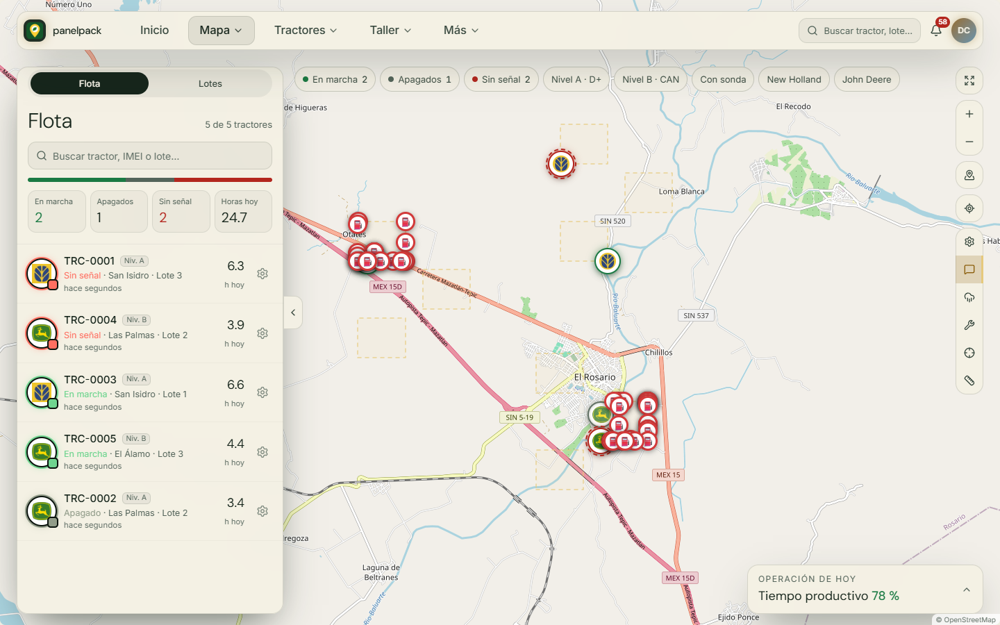 |
| 3 | Tractores | `#/tractores` | 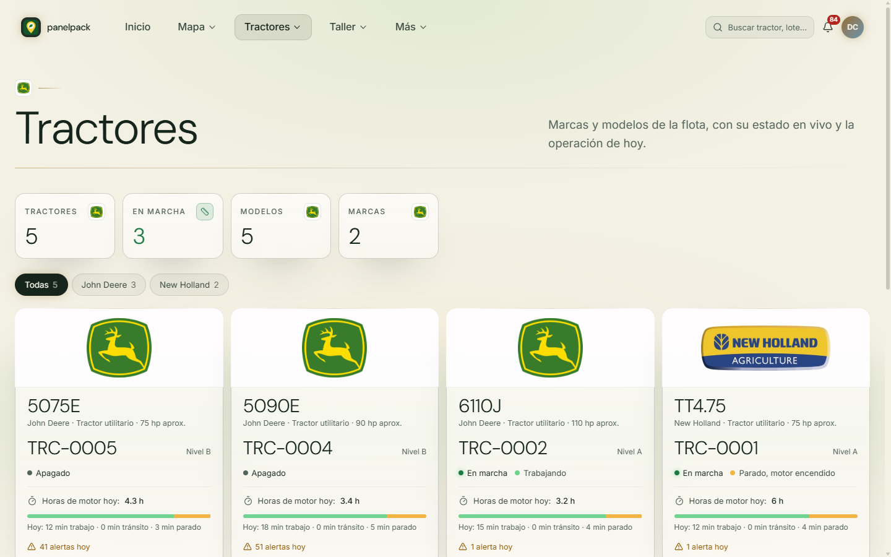 |
| 4 | Lotes | `#/lotes` | 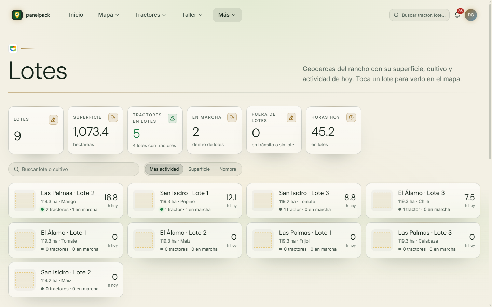 |
| 5 | Alertas | `#/alertas` | 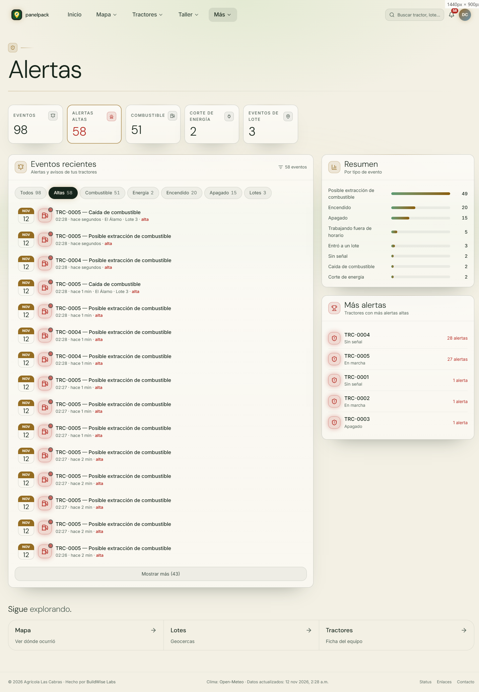 |
| 6 | Reportes | `#/reportes` | 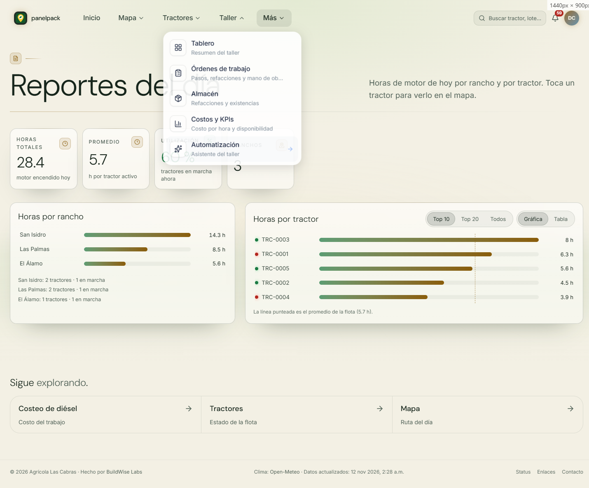 |
| 7 | Costeo | `#/costeo` | 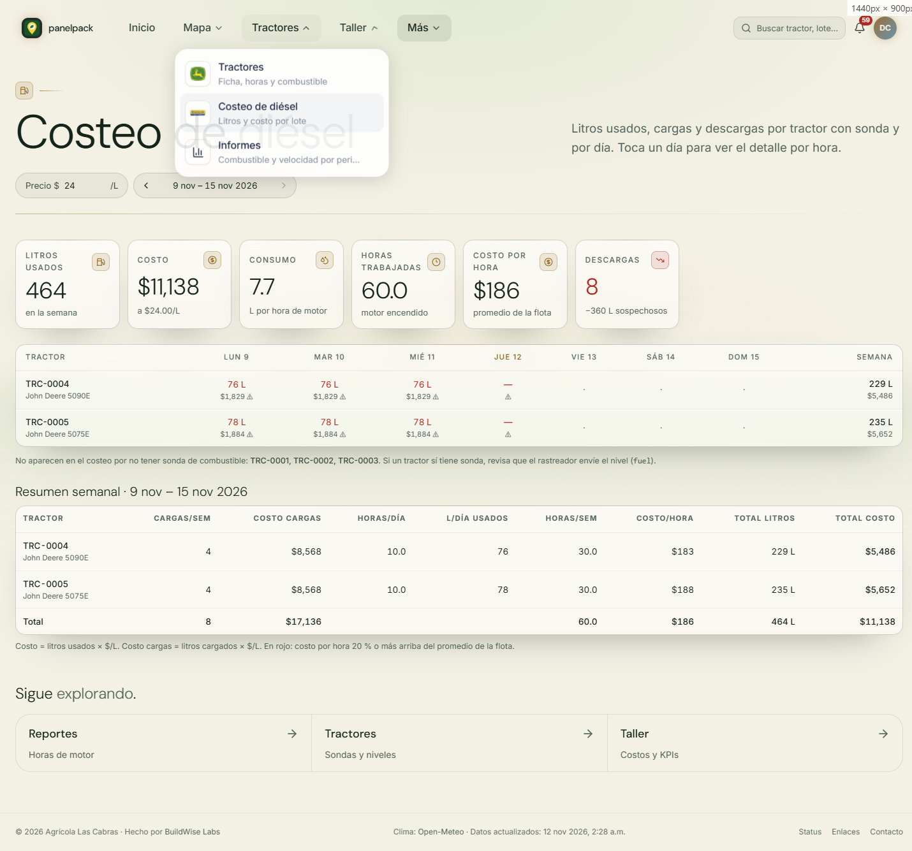 |
| 8 | Taller | `#/taller` | 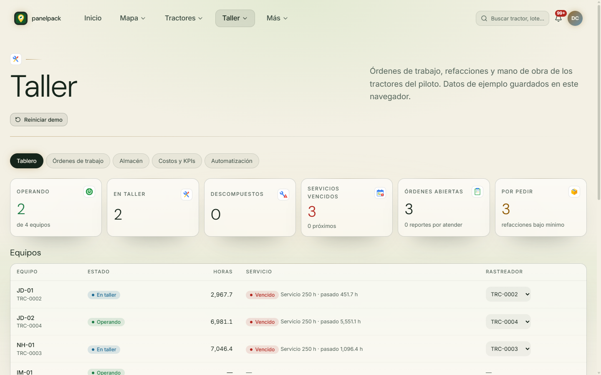 |
| 9 | Informes | `#/informes` | 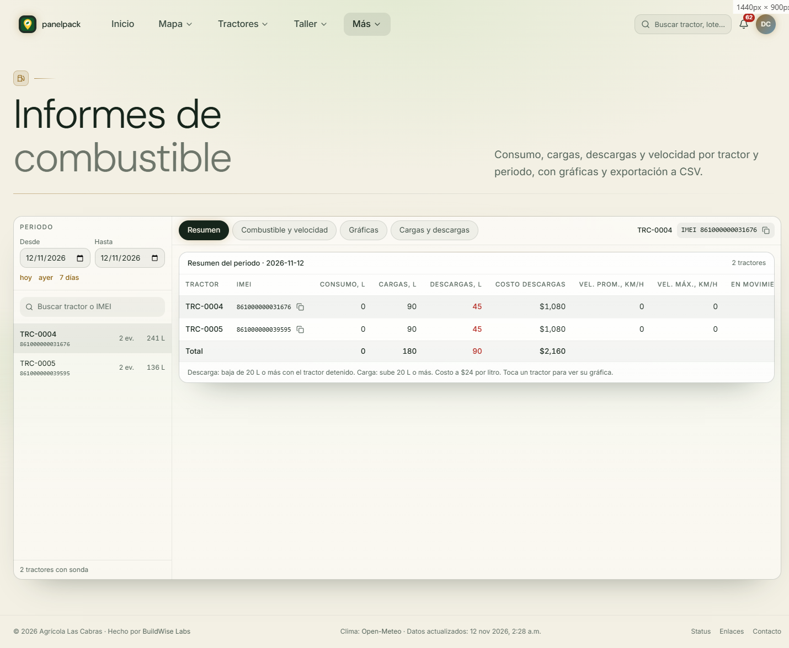 |
| 10 | Enlaces | `#/enlaces` | 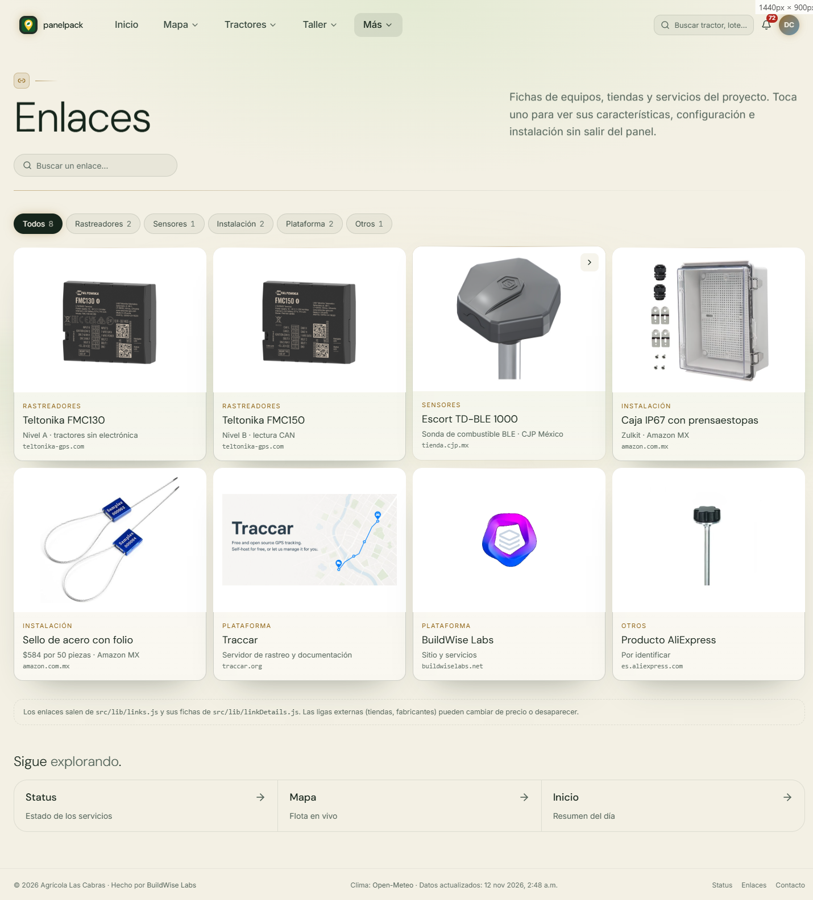 |
| 11 | Status | `#/status` | 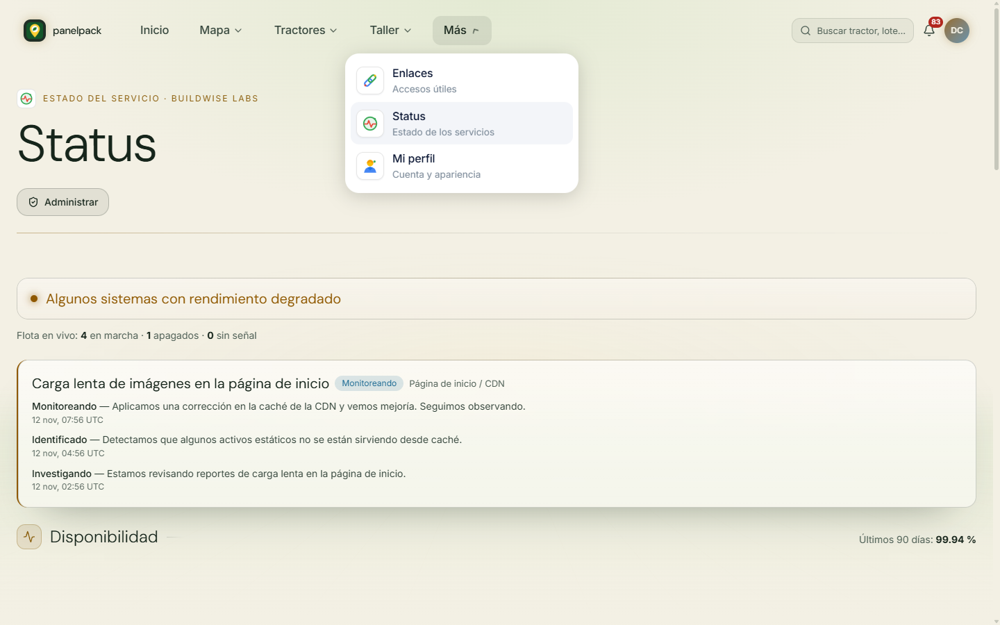 |
| 12 | Perfil | `#/perfil` | 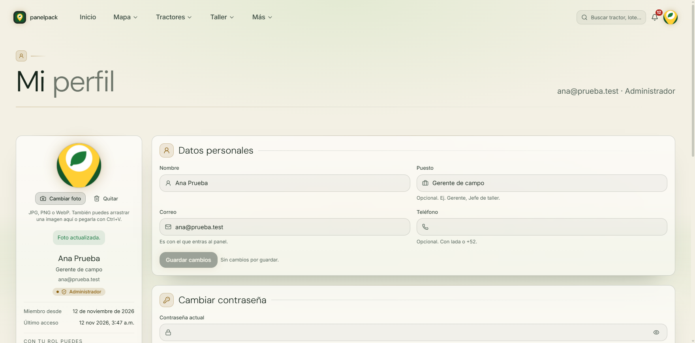 |
| 13 | Ajustes | `#/ajustes` | 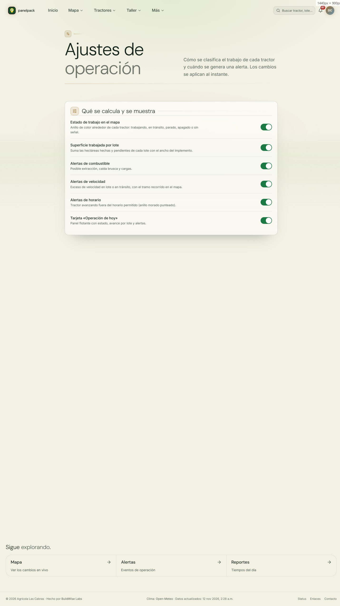 |
| 14 | Búsqueda | `#/buscar` | 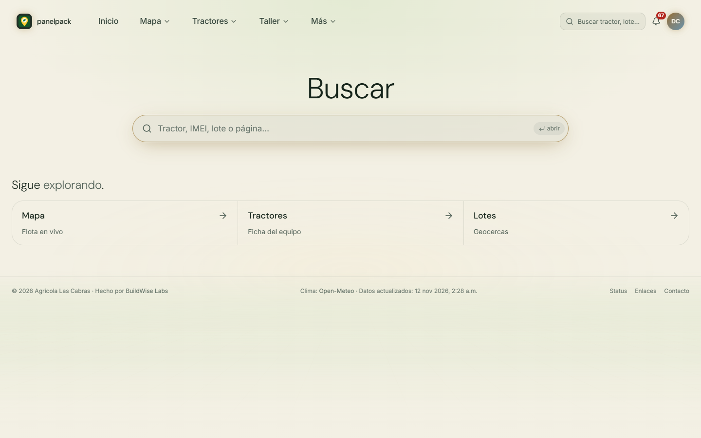 |

No capturadas: la pantalla de acceso (Login), la app instalable del bot (`/bot/`), la pestaña Automatización del Taller con
el chat, y los otros temas (noche, bosque, contraste).

## Modificaciones (según `LEEME.md`)

El repositorio todavía no tiene commits, así que esta lista sale del `LEEME.md` de la carpeta, no del historial de git.

| Fase | Contenido | Estado |
|---|---|---|
| 1 | Base, sistema de diseño, acceso, barra superior flotante, Inicio | Hecha |
| 2 | Mapa en vivo (Leaflet), lista de tractores, filtros, operación de hoy, búsqueda | Hecha |
| 3 | Tractores, Lotes, Alertas, Reportes, Costeo, Enlaces, Status, Perfil | Hecha |
| 4 | Taller (OT, almacén, costos/KPIs) y Automatización | Hecha |
| 5 | Comparar con el panel actual y publicar | Falta probar en celular, probar con `panel-flota-agents/` real y publicar `dist/` |

Cambios destacados:

- **Inicio:** portada larga con estructura de página de producto (portada con foto, frase fija, tres vistas, bento, API,
  números, piloto, preguntas). Sustituye al orden anterior (indicadores, accesos, Operación, Atención, Actualidad, El campo).
- **Mapa:** capas oscuro/satélite/híbrido, herramientas del mapa (rastro, calor, etiquetas, alertas de lote, lluvia, paradas,
  cobertura, NDVI, reproducción de ruta), herramientas interactivas (Inspector, Radio, Notas, Buscar con `/`, Compartir vista)
  y tarjeta «Operación de hoy» (Estado / Avance / Alertas).
- **Barra superior:** los menús Inicio, Mapa, Tractores, Taller y Más se abren al pasar el cursor o enfocar con teclado.
- **Taller:** Tablero, Órdenes, Almacén, Costos y KPIs; lógica portada sin cambios de `panelpack/assets/taller.js`.
- **Automatización:** chat con assistant-ui, un chat por operador, avisos al jefe; usa el agente de `panel-flota-agents/` y, si no está
  en línea, reglas locales.
- **Temas:** noche, claro, bosque y contraste, a partir de `design/tokens.json` (servidor MCP `panel-design`).
- **Bot instalable (PWA):** `/bot/`, solo el chat, con service worker y modo sin conexión.

## Mejoras aplicadas tras revisar las capturas (12 nov 2026)

Las capturas de arriba ya son **después** de estos cambios (tema claro, 1440×900).

| # | Cambio | Dónde |
|---|---|---|
| 1 | «Hoy: 0 min trabajo…» con la barra llena → con menos de 1 min medido dice «midiendo…» y no pinta barra; «<1 min» en vez de «0 min»; «Tiempo productivo» del mapa queda en «Midiendo…» hasta 1 min de motor encendido | `Tractores.jsx`, `ops.js` (`fmtDur`), `store.js` (`summary`) |
| 2 | Costeo se quedaba «calculando…» para siempre: los trabajos cancelados (cambio de semana o doble montaje) dejaban celdas en «cargando». Ahora se liberan, y se avisa qué tractores no tienen sonda | `Costeo.jsx` (`useDays`) |
| 3 | Taller ↔ flota: cada equipo muestra su tractor (`TRC-000X`); botón «Vincular por marca y modelo» (coincidencia única). Con GPS real vincula solo; con datos simulados no, porque su horómetro es inventado y pisaría las horas del taller | `taller/vincular.js`, `Tablero.jsx`, `Taller.jsx` |
| 4 | `deviceOffline` → «Sin señal» y otros tipos de Traccar en español | `lib/events.js` |
| 5 | Resumen de Alertas sin cortar («Posible extracción de combustible»); tarjetas de Tractores con 2 líneas | `Alertas.jsx`, `Tractores.jsx` |
| 6 | Alertas abre en «Altas» si las hay (si no, en «Todos») | `Alertas.jsx` |
| 7 | Logo de BuildWise (96 px) ya no se estira ni se ve pixelado | `Enlaces.jsx` |
| 8 | «Sigue explorando» compacto (título más chico, tarjetas más bajas, menos margen) | `layout/Next.jsx` |
| 9 | Tractores con una sola unidad muestran el tractor (nombre, nivel, estado) en vez de «1 unidad» | `Tractores.jsx` |
| 10 | Contraste del tema claro: `faint` de 3.2:1 a 4.6:1; subtítulos y palabra final de los títulos más oscuros | `design/tokens.json`, `ui/page.jsx`, `HomeSections.jsx` |
| 11 | «Reiniciar demo» como botón con icono; tarjetas del tablero no se estiran | `Taller.jsx`, `Tablero.jsx` |
| 12 | «Operación de hoy» del mapa abre desplegada solo en pantallas de 1600 px o más (la elección se recuerda) | `lib/units.js` |
| 13 | Errores de consola: (a) `mock.js` fallaba si no había tractores en línea; (b) clave repetida en alertas de operación (ids duplicados en el mismo milisegundo, también los ya guardados); (c) 404 de la foto de perfil repetido en cada visita | `api/mock.js`, `fleet/store.js`, `api/panel.js` |
| 14 | El globo de la campana cuenta solo las alertas altas **sin ver**; se limpia al abrir la campana | `layout/TopBar.jsx` |
| 15 | Revisado en celular (390 px), 17 rutas × 4 temas: sin desbordes horizontales | (solo verificación) |
| 16 | Tarjetas de Tractores: se quitó el tractor dibujado y la cabecera muestra el logo grande de la marca (el logo pequeño junto al modelo ya no hace falta) | `Tractores.jsx` |
| 17 | Mapa: el formulario de «Nueva nota» (y el inspector y el radio) queda pegado abajo, por encima de la hoja de la flota en celular, con scroll propio si la pantalla es baja | `fleet/MapInteractUI.jsx` |

Pruebas: 95 (antes 88); se agregaron `events.test.js` y `vincular.test.js`. `npm run build` en verde.

### Después: íconos del menú y fichas de Enlaces

| # | Cambio | Dónde |
|---|---|---|
| 18 | «Mapa en vivo» (menú Mapa) y la portada de Inicio usan los SVG de Google Maps de `src/assets/` | `layout/TopBar.jsx`, `pages/Home.jsx` |
| 19 | 11 SVG nuevos del mismo estilo y paleta para el resto del menú (Alertas, Reportes, Lotes, Buscar, Informes, Tablero, Órdenes, Almacén, Costos y KPIs, Automatización, Mi perfil) | `src/assets/menu/*.svg`, `layout/TopBar.jsx` |
| 20 | Cada enlace de **Enlaces** abre su propia ficha dentro del panel (`#/enlaces/fmc130`, `fmc150`, `escort-tdble1000`, `caja-ip67`, `sello-acero`, `traccar`, `buildwise`, `aliexpress-pendiente`) con Resumen, Características, Configuración, Instalación y Fuentes; el sitio oficial queda como botón | `pages/EnlaceDetalle.jsx`, `lib/linkDetails.js`, `lib/links.js` |

| 21 | Íconos a color también en el **encabezado de cada página**, en los **indicadores** (Tractores, Modelos, Marcas, Lotes, Alertas, Combustible…) y en los títulos de sección. Más SVG: Costeo, Taller, Enlaces, Status y Ajustes, y otros 13 por significado para los indicadores (Costo, Consumo, Horas, Cargas, Descargas, Superficie, En marcha, Energía, Porcentaje, Servicio, Descompuesto, Notas, Apariencia): 29 en total en `src/assets/menu/`. Para «Tractores» se usa el logo de John Deere (`public/brands/john-deere.png`), no un dibujo. Se asignan por palabra clave del título en `ui/menuIcons.js`; si no hay SVG se queda el ícono de línea | `ui/menuIcons.js`, `ui/index.jsx`, `ui/page.jsx` |
| 22 | Ficha del tractor seleccionado en el mapa: solo el logo de la marca en grande (sin el tractor dibujado) y etiqueta de estado legible en tema claro | `fleet/FleetPanel.jsx` |

### Mapa: servicios sin clave (Google Maps solo con enlaces)

| # | Cambio | Dónde |
|---|---|---|
| 23 | **Inspector:** lugar (Nominatim) y elevación (Open-Meteo) del punto; botón **Ruta por camino** (OSRM) con distancia y tiempo, tramo punteado hasta el camino y avisos (punto lejos de un camino, camino mucho más largo que la línea recta); enlaces «Cómo llegar», «Street View» y «Google Maps» | `fleet/mapInteract.js`, `MapInteractUI.jsx`, `lib/mapApis.js` |
| 24 | **Ficha del tractor:** tarjeta «Ubicación» con «¿Dónde está?» (lugar y elevación, solo al pulsar) y enlaces de Google | `fleet/UbicacionTractor.jsx` |
| 25 | **Clima por lote:** temperatura, viento (con flecha) y veredicto Favorable / Precaución / No recomendable sobre cada lote, con resumen y lista en el panel; se renueva cada 15 min | `fleet/mapTools.js`, `MapToolsPanel.jsx`, `styles.css` |
| 26 | **Importar lotes** (KML/GeoJSON → vista previa → crear al confirmar) y **exportar** recorridos y lotes (GPX, KML, GeoJSON) | `fleet/ImportarExportar.jsx`, `lib/geoFormats.js`, `api/*.js` (`createGeofence`), `fleet/store.js` (`addFence`) |

Capturas: `20-mapa-clima-lotes.png`, `21-mapa-inspector-ruta.png`, `22-ficha-tractor-ubicacion.png`, `23-mapa-importar-exportar.png`. Pruebas: 135. Detalle de servicios, privacidad y pendientes: `docs/backend/MAPA-SERVICIOS-EXTERNOS.md`.

Cada dato de una ficha indica su **origen**: *Proyecto* (docs/ del repositorio), *Fabricante* / *Tienda* (consultados el 12 nov 2026) o *Confirmar* (distribuidores o buscadores; contrastar con la hoja de datos). Lo que no se pudo verificar no se inventó: queda como aviso.

Capturas: `15-menu-mapa.png`, `16-enlace-fmc130.png`, `17-enlace-fmc130-specs.png`, `18-enlace-fmc130-config.png`.

Hallazgos de las fichas que conviene revisar:

- **FMC150 en «End of life»** en la página oficial de Teltonika (sin fechas ni reemplazo nombrado); la propuesta compra 32. Confirmar con el distribuidor antes de pedir.
- Las páginas oficiales no mostraron la tabla de especificaciones: alimentación, batería, medidas y E/S del FMC130/FMC150 quedan como «Confirmar» hasta tener la hoja de datos (DS-FMC130 / DS-FMC150).
- Sonda Escort: la tienda no da lista de compatibilidad BLE; confirmar que el FMC130 la lee antes de comprar las 16.
- Caja IP67: no se pudieron consultar sus medidas; verificar que el rastreador quepa antes de comprar 89.

### Mi perfil pulido

| # | Cambio | Dónde |
|---|---|---|
| 27 | **Foto:** editor de encuadre (zoom, arrastrar, girar), subir por archivo, arrastrando o con Ctrl+V, confirmación al quitarla, errores claros (sesión vencida, red caída, tamaño) y la foto también sale en la barra superior | `pages/PerfilFoto.jsx`, `lib/photo.js`, `app/avatar.js`, `layout/TopBar.jsx` |
| 28 | **Datos:** validación por campo, «Guardar» solo con cambios válidos, «Descartar», aviso al salir con cambios, campo Puesto y teléfono normalizado | `pages/Perfil.jsx`, `lib/perfil.js` |
| 29 | **Seguridad:** la contraseña actual es obligatoria (también en la API), ver/ocultar contraseña, requisitos en vivo, y las cuentas de Google/Apple pueden crear una | `pages/Perfil.jsx`, `panel-flota-api/src/app.mjs` |
| 30 | **Cuenta:** rol con su nombre, miembro desde, último acceso y qué permite el rol; «Cuentas» (admin) usa los roles reales (administrador, jefe de almacén, supervisor, operador) | `pages/Perfil.jsx`, `lib/roles.js` |
| 31 | **API en memoria** (`dev:memory`): ids numéricos y foto de perfil guardada; antes no dejaba editar perfil ni subir foto | `panel-flota-api/test/fake-repo.mjs` |

Capturas: `12-perfil.png`, `24-perfil-editor-foto.png`. Pruebas: 159 en el panel y 20 en la API.

## Pendientes

- Probar con `panel-flota-agents/` real y publicar `dist/`. Falta una revisión visual en celular (solo se midieron desbordes, no se miraron las pantallas).
- Revisar las políticas de uso de OpenStreetMap/Esri antes de producción.
- ~74 colores escritos a mano en JS (herramientas del mapa, gráficas de Costeo, marcas de estado); `find_hardcoded_colors` los lista.
- Enlaces: «Producto AliExpress · Por identificar» sigue igual; falta que alguien diga qué producto es.
- Simulador: genera muchas «Posible extracción de combustible» para TRC-0004/0005 (49 en unos 20 min de sesión), lo que infla «Alertas altas» y la campana. Es del simulador, no del panel.
- En Taller con datos simulados, vincular a mano deja «Servicio vencido» por el horómetro inventado de la flota.
